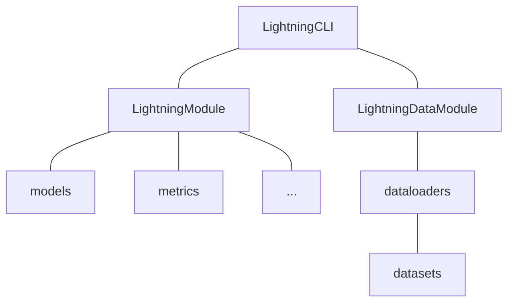

# DarkStream: real-time speech anonymization with low latency

### Waris Quamer, Ricardo Gutierrez-Osuna


**Abstract :**
We propose DarkStream, a streaming speech synthesis model for real-time speaker anonymization. 
To improve content encoding under strict latency constraints, DarkStream combines a causal waveform 
encoder, a short lookahead buffer, and transformer-based contextual layers. To further reduce 
inference time, the model generates waveforms directly via a neural vocoder, thus removing 
intermediate mel-spectrogram conversions. Finally, DarkStream anonymizes speaker identity by 
injecting a GAN-generated pseudo-speaker embedding into linguistic features from the content encoder. 
Evaluations show our model achieves strong anonymization, yielding close to 50% speaker verification 
EER (near-chance performance) on the lazy-informed attack scenario, while maintaining acceptable 
linguistic intelligibility (WER within 9%). By balancing low-latency, robust privacy, and minimal 
intelligibility degradation, DarkStream provides a practical solution for privacy-preserving 
real-time speech communication.

Visit our [demo website](https://warisqr007.github.io/demos/darkstream/) for audio samples.


## Checkpoints

| Model type    |  Lookahead  |  Link  |
|---------------|-------------|--------|
| Wav           |  0 ms       |        |
| Wav + CL      |  0 ms       |        |
| Wav           |  140 ms     |        |
| Wav + CL      |  140 ms     |        |
| Wav + CL + KM |  140 ms     |        |
| Wav           |  280 ms     |        |
| Wav  + CL     |  280 ms     |        |


## Usage

### Installation

```bash
# Clone project
git clone https://github.com/DavidZhang73/pytorch-lightning-template <project_name>
cd <project_name>

# [Optional] Create a conda virtual environment
conda create -n <env_name> python=<3.8|3.9|3.10>
conda activate <env_name>

# [Optional] Use mamba instead of conda to speed up
conda install mamba -n base -c conda-forge

# [Optional] Install PyTorch according to the website to get GPU support
# https://pytorch.org/get-started/

# Install dependencies
pip install -r requirements.txt
```


### Run

**Fit**

```bash
python src/main.py fit -c configs/data/mnist.yaml -c configs/model/simplenet.yaml --trainer.logger.name exp1
```

**Resume**

```bash
python src/main.py fit -c configs/data/mnist.yaml -c configs/model/simplenet.yaml --ckpt_path <ckpt_path> --trainer.logger.id exp1_id
```

### Inference

See [inference.ipynb](inference.ipynb)


### Project Architecture



### File Structure

```text
├── configs                  # Configuration files
│   ├── data                 # Dataset configuration
│   │   └── mnist.yaml       # Example configuration for MNIST dataset
│   ├── model                # Model configuration
│   │   └── simplenet.yaml   # Example configuration for SimpleNet model
│   └── default.yaml         # Default configuration
├── data                     # Dataset directory
├── logs                     # Log directory
├── notebooks                # Jupyter Notebook directory
├── scripts                  # Script directory
│   └── clear_wandb_cache.py # Example script to clear wandb cache
├── src                      # Source code directory
│   ├── callbacks            # Callbacks directory
│   │   └── __init__.py
│   ├── data_modules         # Data module directory
│   │   ├── __init__.py
│   │   └── mnist.py         # Example data module for MNIST dataset
│   ├── metrics              # Metrics directory
│   │   └── __init__.py
│   ├── models               # Model directory
│   │   ├── __init__.py
│   │   └── simplenet.py     # Example SimpleNet model
│   ├── modules              # Module directory
│   │   ├── __init__.py
│   │   └── mnist_module.py  # Example MNIST module
│   ├── utils                # Utility directory
│   │   ├── __init__.py
│   │   └── cli.py           # CLI tool
│   ├── __init__.py
│   └── main.py              # Main program entry point
├── .env.example             # Example environment variable file
├── .gitignore               # Ignore files for git
├── .project-root            # Project root indicator file for pyrootutils
├── LICENSE                  # Open source license
├── pyproject.toml           # Configuration file for Black and Ruff
├── README.md                # Project documentation
├── README_PROJECT.md        # Project documentation template
├── README_ZH.md             # Project documentation in Chinese
└── requirements.txt         # Dependency list
```

### Configuration

1. Define dataset by inheriting `pl.LightningDataModule` in `src/data_module`.
2. Define dataset configuration file in `configs/data` as parameters for the custom `pl.LightningDataModule`.
3. Define the model by inheriting `nn.Module` in `src/models`.
4. Define metrics by inheriting `torchmetrics.Metric` in `src/metrics`.
5. Define training module by inheriting `pl.LightningModule` in `src/modules`.
6. Define the configuration file for the training module in `configs/model` as parameters for the custom `pl.LightningModule`.
7. Configure `pl.trainer`, logs and other parameters in `configs/default.yaml`.

## Tips

### `print_config`

Using the `print_config` functionality of `jsonargparse`, you can obtain the parsed arguments and generate default `yaml` files. However, it is necessary to first configure the `yaml` files for `data` and `model`.

```bash
python src/main.py fit -c configs/data/mnist.yaml -c configs/model/simplenet.yaml --print_config
```

[Prepare a config file for the CLI](https://lightning.ai/docs/pytorch/stable/cli/lightning_cli_advanced.html#prepare-a-config-file-for-the-cli)

### Customized `LightningCLI`

This template implements a custom `CLI` (`CustomLightningCLI`) to achieve the following functions,

- When starting the program, the configuration file is automatically saved to the corresponding log directory, for `WandbLogger` only.
- When starting the program, save configurations for optimizer and scheduler to loggers.
- When starting the program, the default configuration file is automatically loaded.
- After the test is completed, the `checkpoint_path` used for testing is printed.
- Add some command line parameters:
    - `--ignore_warnings` (default: `False`): Ignore all warnings.
    - `--test_after_fit` (default: `False`): Automatically test after each training.
    - `--git_commit_before_fit` (default: `False`): `git commit` before each training, the commit message is `{logger.name}_{logger.version}`, for `WandbLogger` only.

[CONFIGURE HYPERPARAMETERS FROM THE CLI (EXPERT)](https://lightning.ai/docs/pytorch/stable/cli/lightning_cli_expert.html)

### Limit `numpy` number of threads

When running on a server, especially when the CPU has a lot of cores (>=24), you may encounter the problem of too many `numpy` processes, which may cause the experiment to inexplicably hang. You can limit the number of `numpy` processes by setting environment variables (in the `.env` file).

```text
OMP_NUM_THREADS=8
MKL_NUM_THREADS=8
GOTO_NUM_THREADS=8
NUMEXPR_NUM_THREADS=8
OPENBLAS_NUM_THREADS=8
MKL_DOMAIN_NUM_THREADS=8
VECLIB_MAXIMUM_THREADS=8
```

> `.env` file is automatically loaded to environment by [`pyrootutils`](https://github.com/ashleve/pyrootutils) via [`python-dotenv`](https://github.com/theskumar/python-dotenv).

[Stack Overflow: Limit number of threads in numpy](https://stackoverflow.com/questions/30791550/limit-number-of-threads-in-numpy)

### Clear `wandb` cache

When you delete an experiment from the `wandb` web page, the cache of the experiment still exists in the local `wandb` directory, you can use the `scripts/clear_wandb_cache.py` script to clear the cache.

[Wandb Python Documentation](https://docs.wandb.ai/ref/python/)

